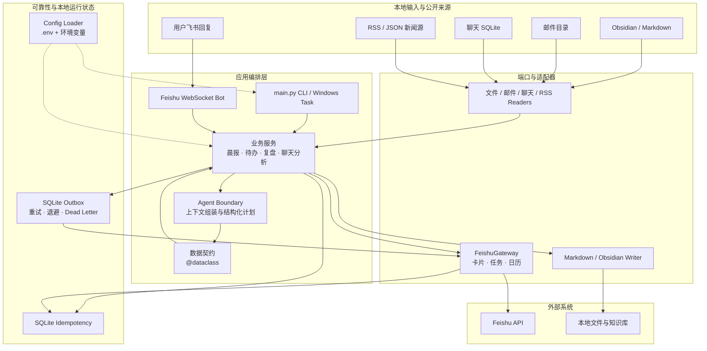

<div align="center">
  
</div>

<div align="center">
  <h1>MorningBriefAgent</h1>
  <p><strong>本地知识库 × Agent 推理 × 飞书行动闭环</strong></p>
  <p>把分散的本地信息，整理成可解释、可确认、可恢复的行动流程。</p>
</div>

<div align="center">
  <a href="https://github.com/wxk2378643343-cloud/MorningBriefAgent/blob/main/LICENSE"></a>
  
  
</div>

<br>

一个 Windows 优先的本地知识库与行动闭环 Agent：把飞书、Obsidian、本地消息、新闻和可选领域数据串成可定时执行的工作流。

项目目前适合个人自托管、二次开发和自动化方案参考；它不是开箱即用的 SaaS，也尚未达到面向多租户的生产级服务标准。源码不包含任何特定用户的目标、作息、学校、职业或生活规划。

> 本项目与飞书、Obsidian、微信或 Google Antigravity 均无官方隶属关系。涉及本地聊天数据库的功能只应处理你有权访问的数据，并遵守所在地法律、平台条款和他人隐私。

## 目录

- [项目背景与定位](#项目背景与定位)
- [技术栈](#技术栈)
- [总体架构](#总体架构)
- [架构思路与采用的方案](#架构思路与采用的方案)
- [功能概览](#功能概览)
- [快速开始](#快速开始)
- [配置](#配置)
- [目录结构](#目录结构)
- [安全与隐私](#安全与隐私)
- [已知限制](#已知限制)
- [贡献方向](#适合贡献的方向)
- [License](#license)

## 为什么做这个项目

我做这个项目的一个很实际的原因是：有些事情我不是不想做，而是懒得每天重复整理、分析和安排。希望把资料交给 AI，让它帮我理解当前状态、梳理重点、给出下一步规划，再把确认后的计划同步到飞书卡片、任务和日历里，提醒自己不要只停留在“想过”。

```text
本地数据与公开信息
        ↓
AI 分析、提炼重点、生成规划
        ↓
飞书卡片 / 任务 / 日历提醒
        ↓
用户回复、确认、执行
        ↓
本地归档、日记、周报、月报
```

我希望数据尽量留在本地。一方面，本地知识库更容易长期保存和回看；另一方面，我比较怀旧，过一段时间重新看到当时的计划、判断和执行记录，会产生很多有意思的感慨，也方便了解自己到底走到了哪里、哪些计划真正完成了、哪些只是当时想得很好。

所以 MorningBriefAgent 不是单纯的新闻推送机器人，而是一套围绕“分析—规划—提醒—执行—回顾”的个人行动闭环。它基于 Google Antigravity 的本地 Agent 能力搭建，也感谢 Google 提供的工具和免费资源，让这套偏个人化的想法有机会真正跑起来。

它的开源价值主要在于：展示如何把本地数据、本地知识库、Agent 分析和飞书 OpenAPI 组合起来，形成可以长期积累的个人工作流。项目不把我的具体目标、作息或生活规划写死在源码中；配置了自己的上下文后，Agent 才会根据本地资料进行个性化分析，没有上下文时则返回通用结果或请求补充信息。

特别感谢 Mr. LD Jiang，感谢你推荐我阅读计算机相关书籍，分享 Agent 相关内容，并一直鼓励我保持尝试和实践。

## 项目背景与定位

个人自动化系统通常会逐渐变成一组互相调用的脚本：新闻抓取、邮件解析、聊天复盘、待办生成和飞书写入各自维护一套规则，最终导致路径写死、个人信息进入源码、重复写入以及失败后无法恢复。

MorningBriefAgent 的目标，是把这类脚本收敛为一个“本地数据 + Agent 推理 + 外部工具执行”的模块化单体应用：

- 本地文件、SQLite、邮件和聊天数据库是可替换的数据输入；
- Agent 负责理解上下文、提炼语义和生成计划，不把个人规划硬编码在 Python 分支中；
- 业务服务只处理领域流程，不直接依赖飞书 SDK 或具体文件路径；
- 飞书卡片、任务、日历和 Obsidian 写入通过统一网关、契约、幂等和 Outbox 保障可恢复性；
- 默认以单用户、自托管、Windows 优先为目标，不伪装成多租户 SaaS。

因此，这个项目更适合作为个人生产力 Agent 的架构样板、飞书自动化的二次开发基础，以及本地敏感数据工作流的工程实践参考。

## 技术栈

| 层面 | 技术与选择 |
| --- | --- |
| 运行时 | Python 3.10+、Windows 10/11 优先 |
| 外部平台 | Feishu/Lark Open API、WebSocket 长连接 |
| Agent | 本地 Agent Provider；通过单一对话边界接入，支持 Mock |
| 本地存储 | Markdown/Obsidian、SQLite、可选本地邮件和聊天数据库 |
| 网络与解析 | `requests`、Python 标准库 RSS/XML/JSON 解析、BeautifulSoup |
| 数据契约 | `dataclass`，用于 Agent 计划、同步命令和跨层数据 |
| 可靠性 | SQLite 幂等键、Outbox、退避重试、Dead Letter、相关性标识 |
| 测试 | Python `unittest`、Mock Provider、临时 SQLite、可选只读真实集成测试 |
| 调度 | Windows 任务计划；不要求常驻 Outbox Worker |

项目刻意保持轻量：配置加载器、文件读取、RSS 解析和测试基线优先使用 Python 标准库；第三方库主要用于飞书 SDK、HTTP、HTML 和压缩数据处理。

## 总体架构



典型执行链路是：

```text
读取输入
  → 标准化为内部数据
  → 组装 Agent 上下文
  → Agent 输出结构化计划
  → 业务服务校验与编排
  → 网关执行外部写入
  → 幂等键 + Outbox 记录结果
  → 用户确认后再落盘或同步
```

## 架构思路与采用的方案

### 1. 模块化单体（Modular Monolith）

项目目前不拆成微服务。所有模块在一个 Python 进程或一次计划任务中运行，但按领域和技术边界拆分为 `core/`、`services/`、`server/` 和 `tests/`。这样保留本地部署的低成本，同时让未来替换 Agent、飞书或数据源时不必重写全部业务逻辑。

### 2. 分层架构 + 六边形架构思想

业务服务位于中心，输入读取器和外部写入网关属于适配器。业务代码依赖内部契约和能力接口，不直接依赖具体 SDK、Windows 路径或某个 RSS 地址。当前项目采用的是“实用的六边形架构思想”，不是完整框架化的依赖注入容器。

```text
输入适配器 → 应用服务 / 领域流程 ← 外部写入适配器
                    ↑
             Agent 与数据契约
```

### 3. Agent 语义边界（Semantic Boundary）

规则适合做格式校验、权限校验、时间范围和幂等判断；“从上下文理解目标、筛选重点、生成计划、解释沟通内容”交给 Agent。项目保留一个统一对话入口，避免每个业务模块都自行拼接 Prompt 或调用模型。

Agent 输出先经过 `dataclass` 契约校验，再进入任务、日历和 Markdown 写入流程。这样模型可以替换，业务层也不会被模型返回格式绑死。

### 4. Ports and Adapters / Anti-Corruption Layer

飞书卡片、任务和日历统一收敛到 `FeishuGateway`；邮件、RSS、聊天数据库和 Markdown 也通过各自 Reader/Writer 隔离。适配器负责把外部格式翻译成内部格式，避免第三方 SDK 的对象和错误类型扩散到业务层。

### 5. 幂等写入 + Transactional Outbox

外部 API 可能出现“请求成功但响应丢失”或网络超时。项目使用稳定业务键和 SQLite 幂等存储防止重复创建，同时用 Outbox 记录待执行副作用：

```text
业务操作
  → 写入 Outbox 意图
  → 调用 Feishu 适配器
  → 成功：succeeded
  → 失败：failed + 退避
  → 超过次数：dead_letter
  → python main.py reconcile 手动重放
```

这是一种适合单机任务调度的可靠性方案，不等同于分布式消息队列；它不需要常驻服务，也不会无限重试失败请求。

### 6. 配置驱动与隐私边界

路径、新闻源、个人上下文、飞书凭据和筛选规则都从环境变量或本地 `.env` 读取。源码只保留脱敏模板，个人规划只存在本地知识库。配置缺失时系统应跳过对应能力或返回诊断信息，而不是猜测用户目录。

### 7. 可测试的外部边界

Provider、Feishu Gateway、RSS、聊天读取器和 SQLite 存储都可以用 Mock 或临时目录测试。默认测试不访问真实飞书、不读取真实聊天库、不写入真实知识库；真实集成测试必须显式开启，并且默认只执行只读检查。

### 不采用的方案

- 不采用微服务：当前规模和部署场景不值得承担网络治理与运维成本；
- 不采用常驻消息队列：Outbox + Windows 计划任务已经满足个人单机可靠性需求；
- 不把规则全部交给 LLM：权限、幂等、数据写入和安全检查必须由确定性代码控制；
- 不把个人目标写进领域模块：这会破坏可复用性，也会增加开源泄露风险；
- 不默认执行真实写入测试：避免测试误创建飞书任务、日历或消息。

## 功能概览

| 能力 | 命令 | 主要依赖 | 当前状态 |
| --- | --- | --- | --- |
| 知识库与晨间简报 | `python main.py brief` | Obsidian、可选本地 Agent、飞书 | 可用，目录结构需适配 |
| 微信沟通复盘 | `python main.py chat` | 合法取得的本地解密库、可选 zstd | 实验性，微信数据库结构可能变化 |
| 国内外与技术资讯 | `python main.py news` | 网络、飞书 | 可用，外部源可能失效 |
| 可选活动与饮食建议 | `python main.py fitness` | Obsidian、飞书 | 可用，内容来自本地数据 |
| 市场与基金摘要 | `python main.py fund` | 网络、飞书 | 实验性，不构成投资建议 |
| 早晚待办闭环 | `todo-morning` / `todo-evening` | 本地上下文、飞书任务与日历 | 可用，计划由 Agent 生成 |
| 双向飞书机器人 | `python main.py bot` | 飞书长连接、本地 AGY 桥接 | 实验性，仅建议单用户自托管 |

## 环境要求

- Windows 10/11；
- Python 3.10 或更高版本；
- 一个已启用机器人能力的飞书企业自建应用；
- 可写入的 Obsidian Vault（使用相关功能时）；
- Google Antigravity 本地 `language_server`（仅双向智能问答需要，属于非标准本地集成）；
- 本地微信解密数据库（仅聊天复盘需要，本项目不提供解密工具或绕过访问控制的方法）。

## 快速开始

```powershell
git clone <your-repository-url>
cd MorningBriefAgent

python -m venv .venv
.\.venv\Scripts\Activate.ps1
python -m pip install -r requirements.txt

Copy-Item .env.example .env
notepad .env
python main.py --help
```

先验证无需私人数据的入口：

```powershell
python -m unittest discover -s tests -v
python -m compileall -q .
python main.py doctor
```

这三个命令就是最小离线运行方式，不需要飞书凭据、微信数据库、
Obsidian Vault 或本地 Agent。只要 Python 3.10+ 和
`pip install -r requirements.txt` 成功，用户即可验证项目基础功能。

默认测试不会访问真实飞书。需要验证本机凭据和只读任务接口时，可显式运行：

```powershell
$env:RUN_LIVE_INTEGRATION="1"
python -m unittest discover -s tests -v
```

真实集成检查只读取任务列表，不创建任务、日历事件或消息。

再按需执行单个服务。建议先运行前台命令观察输出，确认配置正确后再接入 Windows 计划任务。

## 配置

项目根目录的 `.env` 会在导入配置时自动加载，已经存在的系统环境变量优先级更高。`.env` 被 Git 忽略；只提交 `.env.example`。

### 必需的飞书配置

```dotenv
FEISHU_APP_ID=cli_xxx
FEISHU_APP_SECRET=replace_me
FEISHU_USER_OPEN_ID=ou_xxx
FEISHU_CHAT_ID=oc_xxx
FEISHU_ALLOWED_OPEN_IDS=ou_xxx
```

`FEISHU_ALLOWED_OPEN_IDS` 是可以触发本地工具的发送者白名单，多个 Open ID 用英文逗号分隔。未配置时默认只允许 `FEISHU_USER_OPEN_ID`；不要为了省事设置成公共范围。

在飞书开发者后台启用长连接事件订阅，并按实际使用的消息、日历和任务 API 申请最小权限。权限名称可能随平台版本变化，以飞书官方控制台提示为准。

### 本地数据路径

```dotenv
VAULT_ROOT=D:\path\to\your\obsidian-vault
EMAIL_INBOX_DIRS=D:\path\to\mail\inbox;D:\path\to\another\mail\inbox
TECH_NEWS_DIR=D:\path\to\technical\digest
NEWS_DOMESTIC_URLS=https://example.com/domestic.json;https://example.com/domestic-live.json
NEWS_WORLD_URLS=https://example.com/world.rss;https://example.com/another-world.rss
NEWS_FALLBACK_LINK=https://example.com/news
WECHAT_TOOLS_DIR=D:\path\to\wechat-decrypt
WECHAT_MSG_DB=D:\path\to\decrypted\message\message_0.db
WECHAT_CONTACT_DB=D:\path\to\decrypted\contact\contact.db
```

`EMAIL_INBOX_DIRS` 是邮件 Markdown 收件目录列表，`TECH_NEWS_DIR` 是可选的技术摘要目录，均使用分号分隔（邮件目录可配置多个）。解析器不会假设任何特定的 Vault 子目录名称；未配置时不会扫描对应数据。

`NEWS_DOMESTIC_URLS` 和 `NEWS_WORLD_URLS` 是可替换的新闻源列表，使用分号分隔；新闻抓取器不再把具体 RSS/API 地址写死在源码中。

外部写入使用稳定幂等键。默认状态文件为 `data/idempotency.sqlite3`（已被 Git 忽略），也可以显式设置：

```dotenv
IDEMPOTENCY_STORE_PATH=D:\path\to\runtime\data\idempotency.json
```

任务按“日期 + 标题”复用，日历按“日期 + 时间槽 + 摘要”复用；同步计划不会删除目标日期中用户手动创建的其他日程。
任务、日历和卡片共用同一个 `execute_once` 幂等执行入口。

如果检测到旧版 `idempotency.json`，程序会自动导入 SQLite，并保留
`idempotency.json.migrated` 作为迁移标记与备份。

Outbox 失败记录会按退避时间重试，默认最多 5 次；超过次数后进入
`dead_letter`，不会被 `reconcile` 无限重复调用。成功记录默认保留 30 天，
可以通过 `OUTBOX_*` 配置调整。该机制仍由 Windows 任务计划定期执行
`python main.py reconcile`，不需要常驻后台进程。

待办输出路径也必须显式配置：

```dotenv
TODAY_TODO_PATH=D:\path\to\knowledge-base\daily-plan.md
TODO_ARCHIVE_DIR=D:\path\to\knowledge-base\plan-archive
REVIEW_DAILY_DIR=D:\path\to\knowledge-base\reviews\daily
REVIEW_WEEKLY_DIR=D:\path\to\knowledge-base\reviews\weekly
REVIEW_MONTHLY_DIR=D:\path\to\knowledge-base\reviews\monthly
STAGED_PLAN_PATH=D:\path\to\MorningBriefAgent\data\staged_plan.json
FITNESS_PLAN_PATH=D:\path\to\knowledge-base\activity-plan.md
FITNESS_LOG_PATH=D:\path\to\knowledge-base\activity-log.md
FITNESS_ARCHIVE_DIR=D:\path\to\knowledge-base\activity-archive
CHAT_ARCHIVE_DIR=D:\path\to\knowledge-base\chat-reviews
```

未配置这些路径时，服务仍可生成 Agent 计划并同步飞书任务/日历，但不会擅自创建或猜测本地知识库目录。

### 本地敏感数据生命周期

聊天数据库、邮件正文、Agent 转录、接收图片、日志和 SQLite
Outbox 都属于本地敏感运行数据，不是项目源码的一部分。它们虽然被
`.gitignore` 拦截，但默认仍以明文保存在本机。建议：

- 只配置程序确实需要读取的目录；
- 定期删除过期日志、图片、转录和已完成的 Outbox 记录；
- 不要把 `data/`、`logs/`、`received_images/` 或 Agent 工作目录上传到公共仓库；
- 在共享电脑上使用磁盘加密和独立 Windows 用户；
- 发生凭据或转录泄露时，立即轮换凭据并清理备份、压缩包和同步盘。

### Agent 上下文与计划

个人目标、偏好、约束和计划只应放在本地知识库，不要写入公开源码。可以显式配置若干 Markdown 文件，或配置一个目录让程序递归读取：

```dotenv
AGENT_CONTEXT_FILES=D:\private\context\goals.md;D:\private\context\preferences.md
AGENT_CONTEXT_DIRS=D:\private\context
```

`AGENT_CONTEXT_FILES` 和 `AGENT_CONTEXT_DIRS` 使用分号分隔。系统会根据当前任务选择相关片段，并将其交给本地 Agent；源码不会假设你的学校、考试、作息、运动项目、投资目标或社交规则。未配置上下文时，待办和时间块不会凭空填充个人计划。

微信群筛选和联系人排除规则也应保留在本地：

```dotenv
WECHAT_GROUP_KEYWORDS=important-group
WECHAT_EXCLUDED_USERNAMES=wxid_example
WECHAT_EXCLUDED_NAME_KEYWORDS=self-notes
```

### 可选的本地 AGY 桥接

```dotenv
AGENTAPI_EXE=C:\path\to\language_server.exe
AGY_BRAIN_DIR=C:\path\to\antigravity\brain
AGY_CONVERSATION_ID=your-conversation-id
```

桥接会动态发现本地进程端口和临时令牌，不再在源码中保存兜底令牌。未配置该部分时，定时推送仍可按各自依赖运行，但机器人的智能问答不可用。

### 私人持仓数据

基金摘要不会从源码读取真实持仓。复制模板并只在本地维护：

```powershell
Copy-Item .\data\portfolio.example.json .\data\portfolio.json
```

`data/portfolio.json` 被 Git 忽略；如需放在其他位置，设置 `PORTFOLIO_FILE`。公开模板仅用于说明数据结构，不含真实持仓，服务也不会自动生成买卖指令。

如国际资讯源必须经过本地代理，可设置：

```dotenv
LOCAL_PROXY=http://127.0.0.1:7890
```

行情接口默认使用 `https://hq.sinajs.cn`，如需替换为其他兼容数据源，可设置 `MARKET_DATA_URL`。

## 飞书机器人

前台调试：

```powershell
python main.py bot
```

后台运行建议直接使用虚拟环境中的 Python：

```powershell
Start-Process -WindowStyle Hidden `
  -FilePath ".\.venv\Scripts\pythonw.exe" `
  -ArgumentList "-m server.feishu_bot_server"
```

仓库不分发 `.vbs` 和 `.bat` 启动脚本；如需 Windows 计划任务，请在本机任务计划程序中直接配置 Python 程序、项目根目录和环境变量。

## Windows 计划任务

创建 Windows 计划任务时建议：

1. 使用当前仓库的绝对路径作为“起始于”目录；
2. 使用虚拟环境中的 Python；
3. 勾选“仅在用户登录时运行”开始调试；
4. 先手动运行一次并检查 `logs/`；
5. 不要把 `.env` 内容写入任务参数或日志。

计划任务属于本机状态，不会随 Git 仓库同步。

## 目录结构

```text
MorningBriefAgent/
├─ core/
│  ├─ agent/             # Agent 上下文、桥接、Provider、数据契约
│  ├─ integrations/      # 外部系统适配器（当前含 Feishu）
│  ├─ parsers/           # 邮件与本地内容解析
│  └─ runtime/           # 配置加载与诊断
├─ services/
│  ├─ planning/          # 待办、日历、周期复盘
│  ├─ communications/    # 聊天摘要
│  ├─ content/           # 新闻与晨报
│  ├─ lifestyle/         # 健身与生活方式
│  └─ finance/           # 基金与市场摘要
├─ server/               # 飞书 WebSocket 长连接机器人
├─ scripts/              # 可选的本地维护脚本（不含 .bat/.vbs 启动器）
├─ tests/                # 离线单元测试与显式运行的手工集成检查
├─ data/                 # 本地运行状态，仅提交 .gitkeep
├─ logs/                 # 本地日志，仅提交 .gitkeep
├─ received_images/      # 飞书图片缓存，仅提交 .gitkeep
├─ .env.example          # 脱敏配置模板
├─ requirements.txt
└─ main.py               # 统一 CLI
```

内部模块统一使用包路径，例如：

```python
from services.planning.daily_todo import morning_routine
from core.integrations.feishu.gateway import feishu_gateway
```

跨系统同步会记录到本地 SQLite Outbox；可通过 `python main.py doctor`
查看待重试或待对账记录，并用 `python main.py reconcile` 重放失败的
卡片、任务和日历写入。重放使用原始本地 payload 和同一套幂等键，
成功记录不会重复写入。Feishu 请求和机器人消息会输出不含正文的
correlation ID、耗时和成功/失败事件，便于定位部分失败。

`tests/manual_*.py` 和 `tests/check_*.py` 会访问本地服务、数据库或真实 Vault，只能手动运行，不属于默认单元测试。

## 安全与隐私

- `.env`、日志、运行时 JSON/数据库和接收图片均被 `.gitignore` 拦截；
- 源码不提供任何真实飞书凭据或个人 ID 的默认值；
- 飞书入站消息在调用本地工具前执行 Open ID 白名单校验；
- 日志不应记录完整消息正文，但运行过程中仍会处理私人数据；
- 本项目没有为本地数据库、图片和 Obsidian 内容提供加密存储；
- 删除本地运行数据前，请自行确认备份与数据保留要求。

开源前仍应执行：

```powershell
git check-ignore -v .env logs\example.log data\example.json received_images\example.png
git grep -n -I -E "FEISHU_APP_SECRET=.+|cli_[A-Za-z0-9]{12,}|ou_[A-Za-z0-9]{12,}|oc_[A-Za-z0-9]{12,}"
```

如果凭据曾出现在源码、终端分享、聊天或截图中，仅仅删除字符串不够；请在飞书后台轮换 App Secret。

## 已知限制

- 部分业务模块仍依赖 Obsidian、微信和飞书的数据格式，需要按本地环境适配；
- 微信数据库模式并非稳定公共接口，版本升级后可能失效；
- 新闻和行情依赖第三方公开源，缺少缓存、重试和数据源健康监控；
- AGY 桥接依赖本地进程与转录日志，不是稳定的公开 SDK；
- 真实飞书测试默认关闭，需要显式设置 `RUN_LIVE_INTEGRATION=1`；
- `python main.py reconcile` 是显式对账入口；尚未启用常驻后台 Outbox worker；
- 外部系统出现“请求已成功但响应丢失”时，仍需依赖 provider 侧查询或人工核对；
- 采用 MIT License，可自由使用、修改与分发，但需保留版权与许可声明。

## 适合贡献的方向

- 继续将数据目录、时间规则和领域模块抽象为可替换配置；
- 为飞书、新闻和行情接口增加 mock 测试；
- 把微信数据读取封装为可替换适配器；
- 增加配置诊断命令，例如 `python main.py doctor`；
- 增加失败重试、指标、健康检查与结构化日志；
- 补充 Linux/macOS 调度方式，降低 Windows 绑定。

## 免责声明

健身、营养和投资相关输出仅用于个人信息整理，不构成医疗、营养或投资建议。任何自动创建、修改或删除飞书任务、日历和 Obsidian 文件的功能，都应先在测试账号和备份数据上验证。

## License

本项目采用 [MIT License](LICENSE)。
